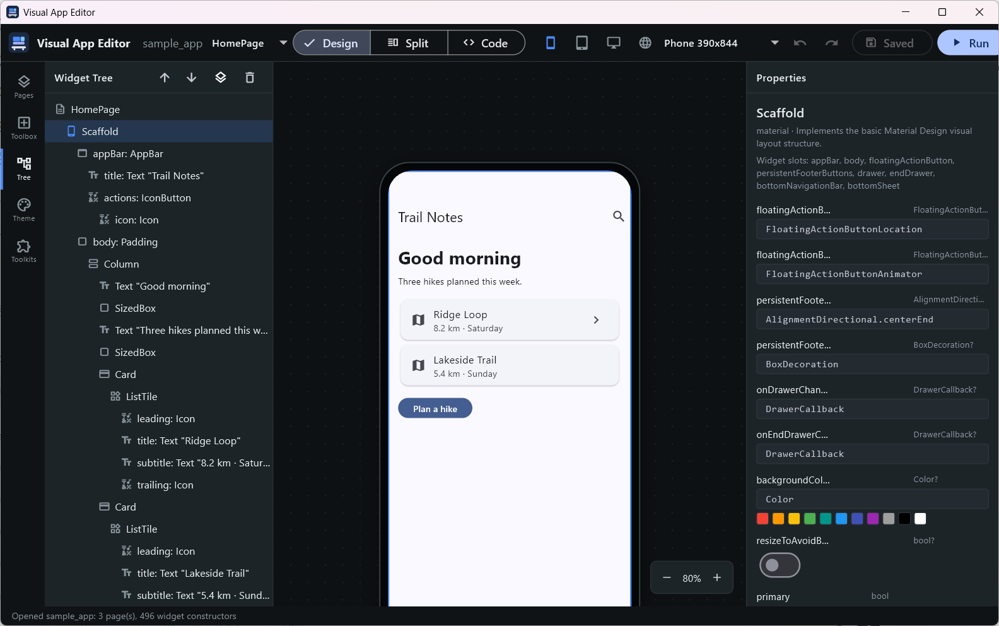

<a id="readme-top"></a>

<div align="center">

<a href="https://github.com/dev-centr/visual-app-editor/graphs/contributors"></a>
<a href="https://github.com/dev-centr/visual-app-editor/network/members"></a>
<a href="https://github.com/dev-centr/visual-app-editor/stargazers"></a>
<a href="https://github.com/dev-centr/visual-app-editor/issues"></a>
<a href="https://github.com/dev-centr/visual-app-editor/blob/main/LICENSE"></a>

<br><br>


<h1>Visual App Editor</h1>

<p>An offline visual editor for app screens that edits your real source code. Flutter today, React and React Native next, with any widget library.</p>

<p>
<a href="https://docs.devcentr.org/visual-app-editor/"><strong>Explore the docs »</strong></a>
<br><br>
<a href="docs/modules/ROOT/pages/getting-started.adoc">Getting started</a>
&middot;
<a href="docs/modules/ROOT/pages/spec.adoc">Architecture</a>
&middot;
<a href="docs/modules/ROOT/pages/protocol.adoc">Protocol</a>
&middot;
<a href="https://github.com/dev-centr/visual-app-editor/issues">Report a bug</a>
</p>

</div>

<details>
<summary>Table of contents</summary>

- [About](#about)
- [Built with](#built-with)
- [Repository layout](#repository-layout)
- [Getting started](#getting-started)
- [Usage](#usage)
- [Toolkits](#toolkits)
- [Roadmap](#roadmap)
- [Contributing](#contributing)
- [License](#license)
- [Contact](#contact)

</details>

## About



Visual App Editor is for developers who want to lay out screens by clicking and dragging without giving up their codebase. It opens an ordinary project and edits its source files directly (`.dart` today; `.tsx`/`.jsx` through the React adapter):

- **Your code stays yours.** A visual edit changes only the expression it touches. Comments, state classes, helpers and formatting elsewhere in the file are kept byte-for-byte. Edits that would not parse are refused.
- **Any widget library.** The toolbox is generated by scanning a package's public widget classes and constructor parameters with `package:analyzer`. Material, Cupertino and the core widgets are bundled; manifests for shadcn_ui, forui, fluent_ui and macos_ui are included, and you can add your own.
- **Offline.** No account and no cloud. It reads the Flutter SDK and pub cache on your machine.
- **One core, many front ends.** A framework-neutral core and a headless JSON-RPC service (LSP-style stdio) do the editing. The desktop app is one client, and IntelliJ / Android Studio and VS Code plugins are planned as further clients.
- **Two previews.** An instant in-process canvas that renders the page from source, and a *Run* button that starts your real app with hot reload on every save.

Panels: pages, toolbox, widget tree, canvas with a phone / tablet / desktop / web mode switcher (responsive presets, not separate layouts), properties, theme, toolkits, and a code view.

> Formerly *Widget Bench*. The repository was renamed in October 2026, and old `widget_bench.sdl` project files are still read.

<p align="right">(<a href="#readme-top">back to top</a>)</p>

## Built with

| Role | Tools |
| --- | --- |
| Runtime and UI | [Flutter](https://flutter.dev) desktop (Windows, Linux, macOS), Material 3 |
| Source analysis | [`package:analyzer`](https://pub.dev/packages/analyzer) (Dart), [TypeScript compiler API](https://github.com/microsoft/TypeScript/wiki/Using-the-Compiler-API) (React / React Native) |
| Service | JSON-RPC 2.0 over stdio with `Content-Length` framing |
| Tooling | Dart pub workspace, Node 20+ with [pnpm](https://pnpm.io) and [Vitest](https://vitest.dev) |
| Configuration | [SDL](https://sdlang.org) (`visual_app_editor.sdl`, toolkit manifests) |
| Docs | AsciiDoc |
| Packaging | [Inno Setup](https://jrsoftware.org/isinfo.php), [AppImage](https://appimage.org), `dpkg-deb`, `hdiutil` |

<p align="right">(<a href="#readme-top">back to top</a>)</p>

## Repository layout

| Path | What | Status |
| --- | --- | --- |
| `packages/core` | `vae_core`: framework-neutral tree, catalog, edit ops, device presets, SDL | implemented |
| `packages/protocol` | `vae_protocol`: JSON-RPC framing, method names, peer | implemented |
| `packages/service` | `vae_service`: headless editing service (`bin/vae_service.dart` on stdio) | implemented |
| `adapters/dart` | Dart/Flutter adapter (`package:analyzer`) and bundled toolkit manifests | implemented |
| `adapters/react` | React / React Native adapter (TypeScript compiler API, Node, pnpm) | first cut: parse, all edit ops, toolkits |
| `apps/desktop` | Flutter desktop app and installer scripts | implemented |
| `plugins/intellij` | IntelliJ / Android Studio plugin (our own, standalone; Kotlin) | first version: tree, properties, toolbox, device switcher |
| `plugins/vscode` | VS Code extension (our own, standalone; TypeScript) | first version: tree, inspector, device switcher |

<p align="right">(<a href="#readme-top">back to top</a>)</p>

## Getting started

### Prerequisites

- The [Flutter SDK](https://docs.flutter.dev/get-started/install) with `flutter` on `PATH` (or `FLUTTER_ROOT` set). Visual App Editor reads widget sources from it.

### Install

Download the installers from the [latest release](https://github.com/dev-centr/visual-app-editor/releases/latest) (currently [v0.1.0](https://github.com/dev-centr/visual-app-editor/releases/tag/v0.1.0)). For a stable URL that follows 0.x updates, use `https://github.com/dev-centr/visual-app-editor/releases/download/v0/<file>`; `v0.1` follows patches only. CI also builds them for every push to `main` as workflow artifacts.

| Platform | Architectures | Package |
| --- | --- | --- |
| Windows | x64, arm64 | `VisualAppEditor-<version>-windows-<arch>-setup.exe` |
| Linux | x64, arm64 | `.AppImage`, `.deb` |
| macOS | arm64 | `.dmg` (unsigned) |

### Build from source

```sh
git clone https://github.com/dev-centr/visual-app-editor.git
cd visual-app-editor
flutter pub get                      # resolves the whole Dart workspace
cd apps/desktop
flutter run -d windows               # or linux / macos
```

React adapter (Node 20+ and pnpm):

```sh
cd adapters/react
pnpm install
pnpm test                            # builds dist/ and runs the tests
```

Headless service: `dart run packages/service/bin/vae_service.dart` speaks the [protocol](docs/modules/ROOT/pages/protocol.adoc) on stdio.

### IDE plugins

The VS Code extension is on the [Visual Studio Marketplace](https://marketplace.visualstudio.com/items?itemName=devcentr.visual-app-editor) (`devcentr.visual-app-editor`). Both plugins are also attached to each [release](https://github.com/dev-centr/visual-app-editor/releases/latest) for installing from a file, and CI uploads them on every push as the `visual-app-editor-intellij` and `visual-app-editor-vscode` artifacts. The IntelliJ plugin isn't on the JetBrains Marketplace yet.

- **IntelliJ IDEA / Android Studio 2026.2+**: *Settings | Plugins | ⚙ | Install Plugin from Disk…*, choose `visual-app-editor-intellij-<version>.zip`, then set the service command under *Settings | Tools | Visual App Editor*.
- **VS Code 1.100+**: `code --install-extension visual-app-editor-<version>.vsix`, then set `visualAppEditor.serviceCommand`.

Both start `dart run <repo>/packages/service/bin/vae_service.dart` (or a compiled `vae_service`). Build them yourself with `./gradlew buildPlugin` in `plugins/intellij` and `pnpm install && pnpm package` in `plugins/vscode`. More: [IDE plugins](docs/modules/ROOT/pages/ide-plugins.adoc), [publishing guide](docs/modules/ROOT/pages/publishing-ide-plugins.adoc).

Installers (run from `apps/desktop`): `packaging/windows/build-installer.ps1`, `packaging/linux/build-packages.sh`, `packaging/macos/build-dmg.sh`.

<p align="right">(<a href="#readme-top">back to top</a>)</p>

## Usage

1. **Open project** and pick a folder with `pubspec.yaml` (or `package.json` when the React adapter is configured), or create the bundled sample project.
2. Choose a page. Click a widget on the canvas or in the tree.
3. Edit values in **Properties**. Values are Dart expressions: `'Hello'`, `24`, `Colors.teal`, `EdgeInsets.all(12)`.
4. Drag widgets from the **Toolbox** onto tree rows, or click to add under the selection. Wrap, reorder and delete from the tree toolbar.
5. **Ctrl+S** saves. **Run** starts the app with `flutter run` and hot reloads on save.

`visual_app_editor <project-folder>` opens a project from the command line; `visual_app_editor --version` prints the version.

<p align="right">(<a href="#readme-top">back to top</a>)</p>

## Toolkits

A toolkit is an SDL manifest naming a package and the folders to scan:

```sdl
toolkit "forui" {
	name "Forui"
	package "forui"
	import "package:forui/forui.dart"
	library "src/widgets"
	exclude "^_" "Style" "Data$"
	category "Buttons" "FButton"
}
```

Put extra manifests in `<project>/.visual_app_editor/toolkits/`. Add the package to your project and run `pub get` so it can be found. Details: [toolkit manifests](docs/modules/ROOT/pages/toolkit-manifests.adoc).

<p align="right">(<a href="#readme-top">back to top</a>)</p>

## Roadmap

- [x] First public release with Windows, Linux and macOS installers ([v0.1.0](https://github.com/dev-centr/visual-app-editor/releases/tag/v0.1.0))
- [ ] Release news post on devcentr.org with an app screenshot
- [ ] Analysis-server diagnostics and import management
- [ ] Select-in-running-app through the VM service inspector
- [ ] Native preview adapters for third-party toolkits
- [ ] Live device modes in the running app with `device_preview`
- [ ] React / React Native canvas preview
- [x] IntelliJ / Android Studio and VS Code plugins (first version, install from file)
- [ ] Plugins on the JetBrains Marketplace, VS Code Marketplace and Open VSX
- [ ] More adapters (Vue, Svelte, Angular, Ionic, Cordova-era HTML, Compose, SwiftUI)

Full roadmap: [architecture and roadmap](docs/modules/ROOT/pages/spec.adoc#roadmap).

<p align="right">(<a href="#readme-top">back to top</a>)</p>

## Contributing

Issues and pull requests are welcome. Run `flutter analyze` at the root, `dart test` in each package, `flutter test` in `apps/desktop`, `pnpm test` in `adapters/react` and `plugins/vscode`, and `./gradlew test` in `plugins/intellij` before opening a pull request, and add a changelog line in `CHANGELOG.adoc` for functional changes.

<p align="right">(<a href="#readme-top">back to top</a>)</p>

## License

MIT. See [`LICENSE`](LICENSE).

<p align="right">(<a href="#readme-top">back to top</a>)</p>

## Contact

Dev-Centr - [github.com/dev-centr](https://github.com/dev-centr)

Project: [github.com/dev-centr/visual-app-editor](https://github.com/dev-centr/visual-app-editor)

<p align="right">(<a href="#readme-top">back to top</a>)</p>
